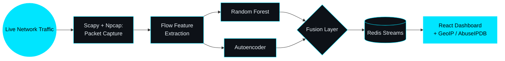
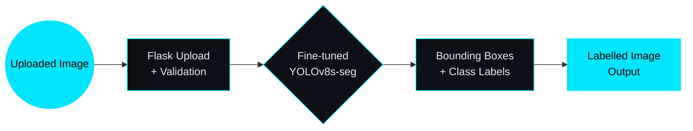

# VISAL SATTAR
### CYBERSECURITY | MACHINE LEARNING | AI SECURITY

  

[LinkedIn](https://linkedin.com/in/visalsattar) · [GitHub](https://github.com/visalsattar) · [Portfolio](https://visalsattar.github.io) · visalsattar.dev@gmail.com

 

### 🖧 CORE FOCUS & CAPABILITIES

Computer Science graduate (BS, Oct 2026, The University of Agriculture, Peshawar). I build network security tools and machine-learning applications, and I like finding where my own systems break. I'm open to entry-level cybersecurity roles and working toward offensive security and AI red teaming.

- 🛡️ **Network Security:** Live packet capture, intrusion detection, network traffic analysis, GeoIP and AbuseIPDB lookups
- 🔧 **Hands-on Tools:** Scapy, Npcap, Linux, Windows, PowerShell, Docker, Git
- 👁️ **Computer Vision:** YOLOv8 object detection and segmentation, dataset preparation, fine-tuning
- ⚙️ **Systems & Infrastructure:** Docker Compose, Redis Streams, Flask, Socket.IO
- 🎯 **Looking For:** Junior Cybersecurity Analyst | Security Engineer | Junior Penetration Tester | Security Operations Analyst

---

### 🛡️ FEATURED PROJECT 01: AI-BASED INTRUSION DETECTION SYSTEM (IDS)
**[Repository →](https://github.com/visalsattar/AI-Based-Intrusion-Detection-System-for-Real-Time-Threat-Detection)** · Final-year project (three-person team; I led the engineering), Jan 2025 – May 2026

> My final year project: a real-time pipeline that captures network traffic, scores it with a Random Forest and an Autoencoder trained on CICIDS2017, and sends enriched alerts to a React dashboard. A CNN was trained offline for comparison and is not part of the live pipeline.

- **Live Capture:** A Scapy sniffer runs on the Windows host through Npcap (as Administrator) and captures TCP and UDP traffic. My own feature extractor rebuilds the 78 CICFlowMeter flow features the models were trained on from packet headers and timing.
- **Results:** Evaluated on a held-out split (45,149 flows; last 20% of rows, unshuffled) of the CICIDS2017 DDoS file (225,745 rows). The Random Forest reached 99.50% F1. The Autoencoder reached 53.78% F1 (59.78% precision, 48.88% recall) at its operating point. Both numbers are as measured, and they cover DDoS traffic only.
- **Real-Time Alerts:** Detections flow through Redis Streams to Flask and out to the React dashboard over Socket.IO, enriched with GeoIP and AbuseIPDB data. Unconfirmed anomaly alerts are capped at MEDIUM severity so they can't trigger blocking.
- **Deployment:** Redis, Flask, and React run in Docker Compose; capture stays on the host. The backend waits for Redis to pass its healthcheck before it starts, so a slow Redis start doesn't crash it.
- **Replay & Live Testing:** Replaying CIC's raw Friday pcap through the live pipeline gave 99.4% recall at 100% precision, after I found and fixed three extractor mismatches that had cut recall to 52%. On live floods from my own devices the ML models did not detect the attack, so I added a model-independent connection-rate rule that caught a real phone's flood within 1 second.
- **Testing:** An automated pytest suite (222 tests) covers preprocessing, train/test leakage, fusion logic, flow scoring, route security and blocking behaviour.
- **Not Done Yet:** No end-to-end capture-to-browser latency measurement (only Redis-to-dashboard delivery, 2.5 ms median, is measured), and the ML models do not detect attack types or traffic shapes they were not trained on.

**Tech Stack:** Python 3.11 | Scapy | Npcap | TensorFlow/Keras | scikit-learn | Flask | Redis Streams | Socket.IO | React | Docker Compose

**Link:** https://github.com/visalsattar/AI-Based-Intrusion-Detection-System-for-Real-Time-Threat-Detection

---

### 🎯 FEATURED PROJECT 02: UNDERWATER TRASH DETECTION WITH YOLOv8
**[Repository →](https://github.com/visalsattar/Underwater_Trash_Detection_with_YOLOv8)** · Personal project, Feb 2024 – Dec 2024

A Flask web app that runs a YOLOv8s segmentation model, fine-tuned on the TrashCan underwater dataset, on an uploaded image and returns it with labelled bounding boxes.

- **Model Fine-Tuning:** Fine-tuned YOLOv8s-seg on the TrashCan underwater dataset (22 classes: 16 trash types plus marine life and ROVs to reduce false detections), reaching 0.712 box mAP@50 and 0.690 mask mAP@50 after a 10-epoch baseline run.
- **Dataset Comparison:** Compared four trash datasets (TrashCan, Trash-ICRA19, Drinking Waste, UAVVaste) in Colab, normalising bounding boxes into YOLO format with Python and OpenCV.
- **Web Service:** A Flask app that returns uploaded images with labelled detections, with filename sanitisation and an image-type allowlist. Segmentation masks are predicted but not yet rendered.

**Tech Stack:** Python | YOLOv8 | PyTorch | OpenCV | Flask | Google Colab

**Link:** https://github.com/visalsattar/Underwater_Trash_Detection_with_YOLOv8

---

### 💼 PROFESSIONAL EXPERIENCE

**Web Development & Database Intern | Bureau of Agriculture Information KP**
*Jun 2023 – Dec 2023*
- Built responsive intranet web pages with HTML5, CSS3, JavaScript, and Bootstrap so staff could use them on phones, tablets, and desktops.
- Designed relational SQL schemas and wrote the queries used for internal data extraction and reporting.
- Wrote a JavaScript time-tracking tool for internal use.

---

### 📜 CERTIFICATIONS & TRAINING

- **Google Cybersecurity Professional Certificate** — Google (Coursera), completed May 2026
- **CompTIA Security+** — in progress, exam planned for early 2027
