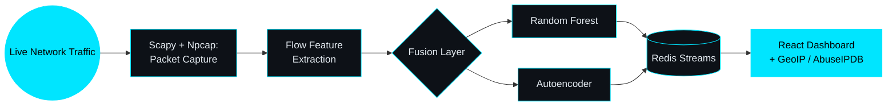
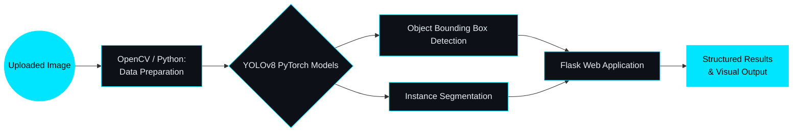

# VISAL SATTAR
### NETWORK DEFENSE | COMPUTER VISION | APPLIED MACHINE LEARNING

  

[LinkedIn](https://linkedin.com/in/visalsattar) · [GitHub](https://github.com/visalsattar)

 

### 🖧 CORE FOCUS & CAPABILITIES

Computer Science graduate (BS, May 2026, The University of Agriculture, Peshawar). I build network security tools and machine-learning applications: capturing live traffic, scoring it with trained models, and showing the results in a real-time dashboard. I'm looking for an entry-level SOC or cybersecurity analyst role.

- 🛡️ **Network Security:** Live packet capture, intrusion detection, network traffic analysis, GeoIP and AbuseIPDB lookups
- 🔧 **Hands-on Tools:** Wireshark, Nmap, Scapy, Npcap, Linux, Windows, Docker
- 👁️ **Computer Vision:** YOLOv8 object detection and segmentation, dataset preparation, fine-tuning
- ⚙️ **Systems & Infrastructure:** Docker Compose, Redis Streams, Flask, Socket.IO
- 🎯 **Looking For:** SOC Analyst | Junior Cybersecurity Analyst | Security or ML Software Engineer

---

### 🛡️ FEATURED PROJECT 01: AI-BASED INTRUSION DETECTION SYSTEM (IDS)
**[Repository →](https://github.com/visalsattar/AI-Based-Intrusion-Detection-System-for-Real-Time-Threat-Detection)** · Final-year project, Nov 2025 – May 2026

> My final year project (Nov 2025 – May 2026): a real-time pipeline that captures network traffic, scores it with a Random Forest and an Autoencoder trained on CICIDS2017, and sends enriched alerts to a React dashboard. A CNN was trained offline for comparison and is not part of the live pipeline.

- **Live Capture:** A Scapy sniffer runs on the Windows host through Npcap (as Administrator) and captures TCP and UDP traffic. My own feature extractor rebuilds the 78 CICFlowMeter flow features the models were trained on from packet headers and timing.
- **Results:** Evaluated on a chronological held-out split (45,149 flows) of the CICIDS2017 DDoS file (225,745 rows). The Random Forest reached 99.50% F1. The Autoencoder reached 53.78% F1 (59.78% precision, 48.88% recall) at its operating point. Both numbers are as measured, and they cover DDoS traffic only.
- **Real-Time Alerts:** Detections flow through Redis Streams to Flask and out to the React dashboard over Socket.IO, enriched with GeoIP and AbuseIPDB data. Unconfirmed anomaly alerts are capped at MEDIUM severity so they can't trigger blocking.
- **Deployment:** Redis, Flask, and React run in Docker Compose; capture stays on the host. The backend waits for Redis to pass its healthcheck before it starts, so a slow Redis start doesn't crash it.
- **Testing:** I checked data cleaning, alert severity thresholds, and service startup by hand, and confirmed a constructed test alert reaches the dashboard end to end.
- **Not Done Yet:** No end-to-end capture-to-browser latency measurement (only Redis-to-dashboard delivery, 2.5 ms median, is measured), a pytest suite that is only scaffolded, and no attack testing on real network hardware.

**Tech Stack:** Python 3.11 | Scapy | Npcap | TensorFlow/Keras | scikit-learn | Flask | Redis Streams | Socket.IO | React | Docker Compose

**Link:** https://github.com/visalsattar/AI-Based-Intrusion-Detection-System-for-Real-Time-Network-Threat-Detection

---

### 🎯 FEATURED PROJECT 02: YOLOv8 WASTE DETECTION & SEGMENTATION ENGINE
**[Repository →](https://github.com/visalsattar/yolo_detection_app)** · Personal project, Feb 2024 – Dec 2024

A Flask web app (Feb 2024 – Dec 2024) that takes an uploaded image and returns detected and segmented waste items, using YOLOv8 models fine-tuned on the ICRA Trash and Drinking Waste datasets.

- **Model Fine-Tuning:** Fine-tuned YOLOv8 detection and segmentation models on waste categories from the ICRA datasets.
- **Web Service:** A Flask app that accepts image uploads and returns structured bounding-box results.
- **Data Preparation:** Cleaned the data, normalized bounding boxes, and applied validation augmentation with OpenCV and Python.

**Tech Stack:** Python | YOLOv8 | PyTorch | OpenCV | Flask | Jupyter Notebook

**Link:** https://github.com/visalsattar/yolo_detection_app

---

### 💼 PROFESSIONAL EXPERIENCE

**Web Development & Database Intern | Ministry of Agriculture — Bureau of Agriculture Information Dept.**
*Jun 2023 – Dec 2023*
- Built responsive intranet web pages with HTML5, CSS3, JavaScript, and Bootstrap so staff could use them on phones, tablets, and desktops.
- Designed relational SQL schemas and wrote the queries used for internal data extraction and reporting.
- Wrote a JavaScript time-tracking tool for internal use.

---

### 📜 CERTIFICATIONS & TRAINING

- **Google Cybersecurity Professional Certificate** — Google (Coursera), completed May 2026
- **CompTIA Security+** — in progress, exam planned for Dec 2026
